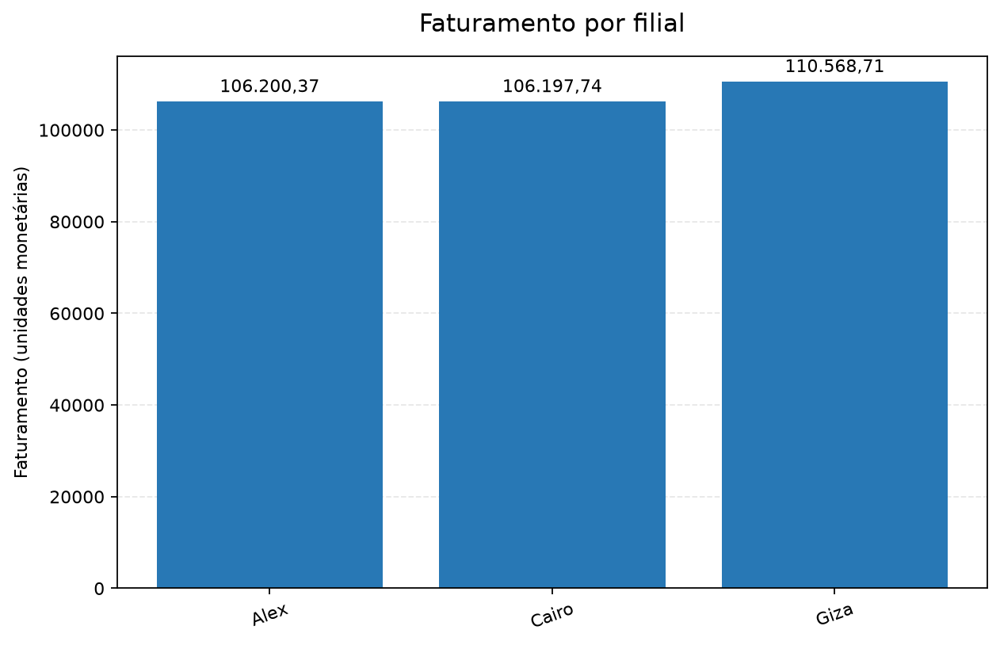
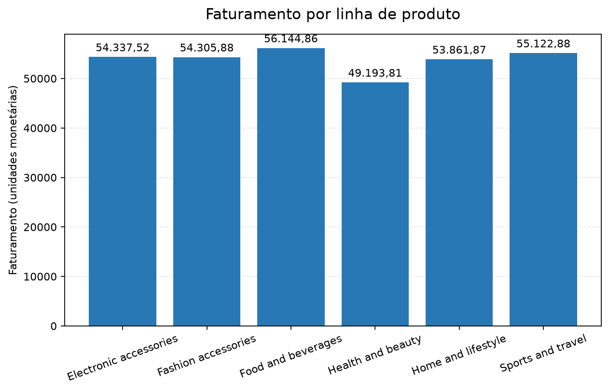
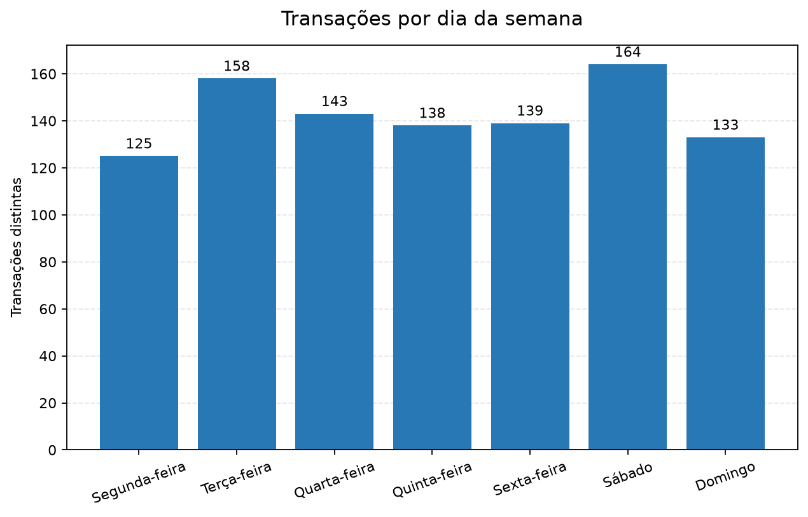

# Projeto Avaliativo Módulo 01 — Análise de Vendas de Supermercado

Projeto de análise do dataset **Supermarket Sales** com PostgreSQL, SQL e Pandas. O fluxo separa a cópia original dos dados (Raw) dos dados tipados e tratados, registra decisões de qualidade, responde às perguntas do enunciado e gera gráficos.

## Fonte dos dados

Dataset indicado no enunciado: [Supermarket Sales no Kaggle](https://www.kaggle.com/datasets/faresashraf1001/supermarket-sales). O arquivo fornecido, `SuperMarket Analysis.csv`, deve ficar em `data/raw/` com esse nome. Não edite o arquivo original: a camada Raw preserva os nomes e valores recebidos da fonte.

### Correspondência com o dicionário do enunciado

O arquivo fornecido usa `Sales` para o valor da venda, enquanto o dicionário do enunciado chama o campo tratado de `valor_total`. O ETL mapeia `Sales` para `valor_total` e confere a fórmula `Unit price × Quantity + Tax 5%` antes do arredondamento. As filiais aparecem na fonte como `Alex`, `Cairo` e `Giza`; esses rótulos são preservados sem substituição na camada Raw e na coluna `filial`.

## Pré-requisitos

- Windows com Python 3.14, Git e VS Code.
- PostgreSQL instalado e em execução, com pgAdmin ou outra ferramenta para executar SQL.
- Conta GitHub para publicar o repositório e entregar o link no AVA.

## 1. Preparar o ambiente Python

Abra a pasta `projeto-avaliativo-modulo-01` no VS Code. No menu **Terminal > Novo Terminal**, execute:

```powershell
python --version
python -m venv .venv
.\.venv\Scripts\python.exe -m pip install -r requirements.txt
Copy-Item .env.example .env
```

Abra `.env` no VS Code e substitua `DB_PASSWORD` pela senha local definida na instalação do PostgreSQL. Confira também `DB_HOST`, `DB_PORT` e `DB_USER` se você escolheu valores diferentes. O arquivo `.env` é local e está ignorado pelo Git; não o envie ao GitHub nem compartilhe sua senha.

## 2. Baixar o CSV

Coloque `SuperMarket Analysis.csv` em `data/raw/`. Não abra e salve novamente em outro formato: a camada Raw deve refletir os valores recebidos da fonte.

## 3. Criar o banco e as tabelas

No pgAdmin:

1. Conecte ao servidor PostgreSQL e abra o Query Tool do banco de manutenção `postgres`.
2. Abra e execute `sql/01_criar_banco.sql`. Esse comando cria `supermarket_sales_db`; execute-o somente uma vez.
3. Atualize a lista de bancos e conecte-se a `supermarket_sales_db`.
4. Abra e execute `sql/02_criar_tabelas.sql` nesse banco. Ele cria `raw_vendas` (campos originais como texto) e `vendas_tratadas` (colunas tipadas e com restrições).

## 4. Carregar e consultar a camada Raw

No terminal do VS Code, ainda na pasta do projeto, execute:

```powershell
.\.venv\Scripts\python.exe src\01_leitura_dados.py
```

O programa inspeciona o CSV, carrega seus valores originais na tabela `raw_vendas` e exporta o resultado de um `SELECT` para `data/raw/vendas_exportadas.csv`. Também compara todas as células e a ordem das linhas exportadas com o CSV de origem. A carga substitui os dados Raw de uma execução anterior; mantenha o CSV original intacto.

Depois, no pgAdmin conectado a `supermarket_sales_db`, abra e execute `sql/03_consultas.sql`. Confira a contagem, a amostra e as agregações da tabela Raw.

## 5. Tratar os dados e carregar a camada Tratada

No terminal do VS Code, execute:

```powershell
.\.venv\Scripts\python.exe src\02_etl_vendas.py
```

O ETL normaliza os nomes, converte tipos, verifica IDs repetidos, valores numéricos, datas, horários e regras de domínio. As decisões e quantidades ficam registradas em `resultados/relatorio_qualidade.csv`. A base tratada é salva em `data/processed/vendas_tratadas.csv` e carregada em `vendas_tratadas`. Consulte `data/processed/dicionario_dados.md` para o mapeamento e as regras de negócio.

## 6. Responder às perguntas e gerar gráficos

Execute:

```powershell
.\.venv\Scripts\python.exe src\03_estatistica.py
```

O programa salva as oito respostas em `resultados/respostas_perguntas_negocio.csv`, o resumo numérico do Pandas em `resultados/estatisticas_descritivas.csv`, um relatório com metodologia, respostas e tabelas em `resultados/respostas_perguntas_negocio.md` e os gráficos PNG em `resultados/`. O relatório distingue faturamento (`Sales`/`valor_total`) de receita bruta (`gross income`/`receita_bruta`). Como a fonte não informa a moeda, valores aparecem em unidades monetárias, sem símbolo de moeda. Os empates são apresentados juntos.

## Resultados obtidos

O pipeline foi executado sobre as 1.000 linhas do CSV. A carga Raw exportou as mesmas 1.000 linhas e preservou todos os campos; a auditoria não encontrou valores ausentes, IDs duplicados, erros de data/horário ou diferenças relevantes na conferência do cálculo de `Sales`. Nenhuma linha precisou ser removida no tratamento.

| Pergunta | Resultado |
|---|---|
| Filial com maior faturamento | Giza — 110.568,71 unidades monetárias |
| Filial com mais vendas | Alex — 340 transações |
| Linha com maior faturamento | Food and beverages — 56.144,86 unidades monetárias |
| Melhor avaliação média | Food and beverages — 7,11 de 10 |
| Forma de pagamento mais usada | Ewallet — 345 transações |
| Valor médio das vendas | 322,97 unidades monetárias |
| Maior venda | 1.042,65 unidades monetárias — venda `860-79-0874` |
| Dia com mais vendas | Sábado — 164 transações |

A fonte não especifica a moeda. O [relatório completo](resultados/respostas_perguntas_negocio.md) apresenta as oito respostas, as tabelas-resumo, as estatísticas descritivas, os critérios de cálculo e os seis gráficos.

Os valores monetários da camada Tratada são arredondados para duas casas decimais, conforme o dicionário de dados; por isso, totais agrupados diretamente na Raw podem diferir por alguns centavos.

### Exemplos de visualizações







## Fluxo resumido

```text
CSV original -> PostgreSQL Raw -> consultas SQL -> exportação CSV
             -> Pandas/ETL -> PostgreSQL Tratada e CSV tratado
             -> estatísticas -> respostas, tabelas e gráficos
```

## Estrutura do projeto

- `sql/`: criação do banco, das tabelas e consultas de exploração.
- `src/`: inspeção e carga Raw, ETL e análise estatística.
- `data/raw/`: CSV original e exportação da consulta Raw.
- `data/processed/`: CSV tratado e dicionário de dados.
- `resultados/`: auditoria de qualidade, respostas, tabelas e gráficos.
- `.env.example`: modelo das configurações locais; a senha real fica somente em `.env`.

## Reprodutibilidade e entrega

As dependências estão registradas em `requirements.txt`. A sequência das seções 1–6 reproduz a análise em uma instalação local. Antes de entregar, confira que o repositório GitHub contém o código, os arquivos SQL, o README, a auditoria, as respostas e os gráficos; que `.env` e credenciais não foram publicados; e que o link correto do repositório foi enviado no AVA. A data e hora limite informadas no enunciado são **05/10/2026 às 22h**.

### Publicar no GitHub

Faça esta etapa depois de executar e revisar o pipeline localmente:

1. Crie no GitHub um repositório vazio, sem inicializar outro README, `.gitignore` ou licença.
2. No terminal do VS Code, aberto na pasta do projeto, associe o URL HTTPS do repositório (substitua `USUARIO` e `REPOSITORIO` pelos seus valores):

   ```powershell
   git remote add origin https://github.com/USUARIO/REPOSITORIO.git
   git push -u origin main
   git push -u origin docs/publicacao-github
   git push -u origin feat/pipeline-vendas
   git push -u origin fix/csv-kaggle-enunciado
   git push -u origin feat/valida-fidelidade-raw
   ```

3. No GitHub, confira a branch `main`, o histórico de commits e os arquivos de resultado. Confirme que a visibilidade do repositório permite ao avaliador acessar o link, conforme a orientação do AVA.
4. Copie o URL do repositório e envie-o na tarefa do Módulo 1 no AVA. Depois da entrega, não faça novos commits ou pushes até receber a nota.
