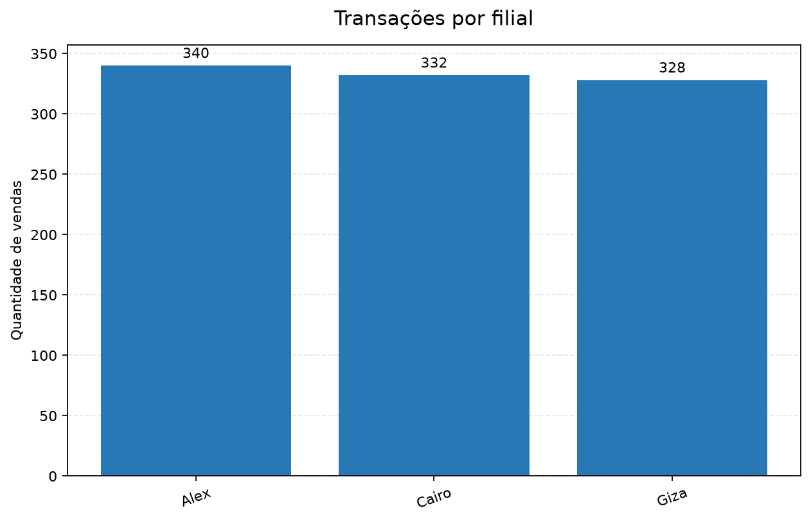
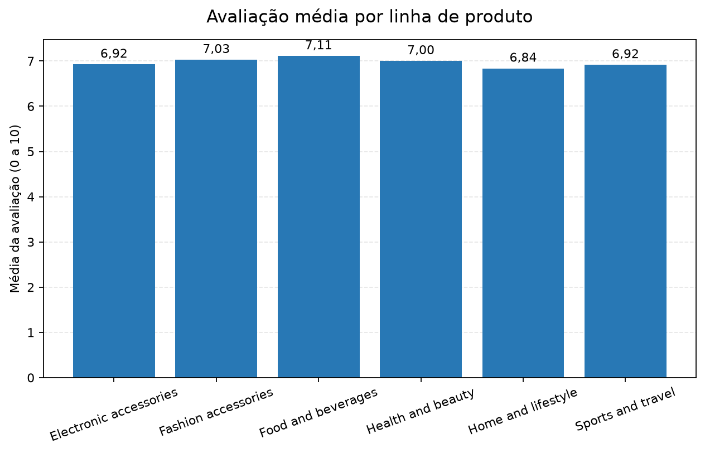
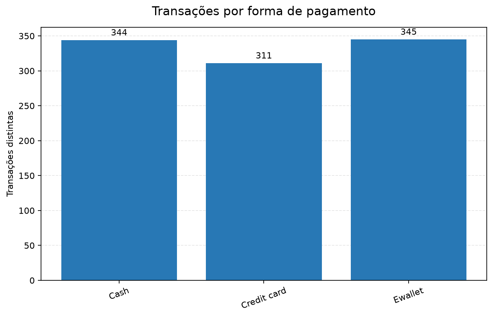

# Pipeline de Dados e Análise de Vendas — Supermarket Sales

Pipeline de dados desenvolvido para ingestão, tratamento, auditoria e análise exploratória a partir de dados transacionais de varejo. O projeto aplica os princípios da arquitetura Medallion para garantir rastreabilidade dos dados brutos, integridade relacional na transformação e consistência analítica nas respostas de negócio.

---

## Arquitetura da Solução

O fluxo organiza os dados em três camadas bem definidas:

1. **Camada Raw (Bronze)**: Ingestão fiel do arquivo de origem no PostgreSQL (`raw_vendas`), preservando valores e cabeçalhos originais como texto (`TEXT`) para auditoria e histórico.
2. **Camada Tratada (Silver)**: Normalização com Pandas e persistência no PostgreSQL (`vendas_tratadas`) e em arquivo (`data/processed/vendas_tratadas.csv`). Aplica tipagem estrita (`NUMERIC`, `DATE`, `TIME`), padronização de nomenclatura (*snake_case*), cálculo da coluna derivada `dia_semana`, checagem da fórmula do total de venda e restrições relacionais (`PRIMARY KEY`, `NOT NULL`, `CHECK`).
3. **Camada Analítica (Gold)**: Extração de métricas de negócio, estatística descritiva e geração de visualizações em `resultados/`.

---

## Estrutura do Diretório

```
projeto-avaliativo-modulo-01/
├── sql/
│   ├── 01_criar_banco.sql          # Criação do banco de dados supermarket_sales_db
│   ├── 02_criar_tabelas.sql        # DDL das tabelas raw_vendas e vendas_tratadas
│   └── 03_consultas.sql            # Queries SQL de exploração Raw e validação Tratada
├── src/
│   ├── 01_leitura_dados.py         # Ingestão, EDA inicial e conferência célula a célula
│   ├── 02_etl_vendas.py            # Pipeline ETL, validação de regras e carga Tratada
│   └── 03_estatistica.py           # Cálculo das respostas de negócio, describe() e gráficos
├── data/
│   ├── raw/                        # CSV original do Kaggle e exportação intermediária SQL
│   └── processed/                  # Base tratada (vendas_tratadas.csv) e dicionário de dados
├── resultados/                     # Tabelas de métricas, auditoria de qualidade e gráficos PNG
├── .env.example                    # Modelo de variáveis de ambiente
├── .gitignore                      # Regras de exclusão de arquivos locais (.env, .venv)
├── requirements.txt                # Dependências do projeto com versões fixadas
└── README.md                       # Documentação técnica da solução
```

---

## Tecnologias Utilizadas

* **Linguagem**: Python 3.14
* **Banco de Dados Relacional**: PostgreSQL 18
* **Processamento e Análise de Dados**: Pandas 3.0.6
* **Visualização de Dados**: Matplotlib 3.11.2
* **Conexão com Banco de Dados**: SQLAlchemy 2.1.1 e driver `pg8000` 1.31.5 (driver em Python puro, eliminando dependências de compilação em C e DLLs nativas)
* **Gestão de Configuração**: python-dotenv 1.2.3

---

## Fonte de Dados e Regras de Negócio

* **Fonte**: Conjunto público [Supermarket Sales (Kaggle)](https://www.kaggle.com/datasets/faresashraf1001/supermarket-sales).
* **Arquivo de entrada**: `data/raw/SuperMarket Analysis.csv` (1.000 linhas e 17 colunas).
* **Faturamento vs. Receita Bruta**:
  * `Sales` representa o valor total da venda ao cliente (`Unit price × Quantity + Tax 5%`), mapeado na camada tratada para `valor_total`. Esse campo é a métrica oficial para cálculo de faturamento e ticket médio.
  * `gross income` representa o lucro bruto apurado na transação, mapeado para `receita_bruta`.
* **Identificação de Filiais**: Os rótulos da coluna `Branch` (`Alex`, `Cairo` e `Giza`) foram preservados sem alterações arbitrárias.
* **Unidade Monetária**: Como a fonte não especifica moeda (ex.: R$, US$), as métricas financeiras são expressas em unidades monetárias padronizadas.

O mapeamento completo de colunas, restrições e regras de validação está registrado em [`data/processed/dicionario_dados.md`](data/processed/dicionario_dados.md).

---

## Guia de Instalação e Execução

### 1. Configuração do Ambiente Virtual

```powershell
# Criação do ambiente virtual
python -m venv .venv

# Instalação das dependências
.\.venv\Scripts\python.exe -m pip install -r requirements.txt

# Configuração das credenciais locais
Copy-Item .env.example .env
```

Abra o arquivo `.env` e configure a senha local de acesso ao PostgreSQL (`DB_PASSWORD`). O arquivo `.env` está isolado pelo `.gitignore` e não é enviado ao repositório.

### 2. Criação do Banco de Dados e Esquema DDL

No PostgreSQL (via pgAdmin ou cliente SQL de preferência):
1. Execute `sql/01_criar_banco.sql` conectado ao banco padrão `postgres` para criar o banco `supermarket_sales_db`.
2. Conecte-se ao banco `supermarket_sales_db` e execute `sql/02_criar_tabelas.sql` para criar a tabela de ingestão `raw_vendas` e a tabela relacional `vendas_tratadas` com suas respectivas *constraints* (`PRIMARY KEY`, `NOT NULL` e validações `CHECK`).

### 3. Execução do Pipeline

Execute os módulos na raiz do projeto na sequência abaixo:

```powershell
# 1. Carga Raw e validação de fidelidade contra o CSV de origem
.\.venv\Scripts\python.exe src/01_leitura_dados.py

# 2. Pipeline ETL, validação de regras de negócio e carga na camada Tratada
.\.venv\Scripts\python.exe src/02_etl_vendas.py

# 3. Análise estatística descritiva, respostas de negócio e geração de gráficos
.\.venv\Scripts\python.exe src/03_estatistica.py
```

### 4. Consultas SQL Analíticas

O script `sql/03_consultas.sql` pode ser executado diretamente no banco `supermarket_sales_db` para auditoria:
* **Parte 1**: Consultas de exploração e conferência de volume sobre a tabela `raw_vendas`.
* **Parte 2**: Consultas analíticas consolidadas sobre `vendas_tratadas`, aproveitando tipagem nativa e índices.

---

## Resultados das Perguntas de Negócio

Consolidação extraída a partir das 1.000 transações validadas na camada Tratada:

| Nº | Pergunta de Negócio | Resposta Obtida | Métrica Utilizada |
|:---:|---|---|---|
| 1 | Filial com maior faturamento | **Giza** (110.568,71 un.) | Soma de `valor_total` por filial |
| 2 | Filial com maior volume de vendas | **Alex** (340 vendas) | Contagem de `id_venda` distintos |
| 3 | Linha de produto com maior faturamento | **Food and beverages** (56.144,86 un.) | Soma de `valor_total` por linha |
| 4 | Linha com melhor avaliação média | **Food and beverages** (7,11 / 10) | Média de `avaliacao` por linha |
| 5 | Forma de pagamento mais utilizada | **Ewallet** (345 transações) | Contagem de transações distintas |
| 6 | Valor médio das vendas (ticket médio) | **322,97 un.** | Média geral de `valor_total` |
| 7 | Maior venda individual registrada | **1.042,65 un.** | Valor máximo (`860-79-0874`, Filial Giza) |
| 8 | Dia da semana com maior volume de vendas | **Sábado** (164 transações) | Contagem de transações por `dia_semana` |

A documentação detalhada das métricas, incluindo medidas de dispersão, quartis e comparação de média e mediana, encontra-se no relatório [`resultados/respostas_perguntas_negocio.md`](resultados/respostas_perguntas_negocio.md).

---

## Visualizações Geradas

Os gráficos gerados pelo pipeline são exportados em formato PNG para o diretório `resultados/`:

### Desempenho por Filial
| Faturamento por Filial | Transações por Filial |
|:---:|:---:|
|  |  |

### Desempenho por Linha de Produto
| Faturamento por Linha de Produto | Avaliação Média por Linha de Produto |
|:---:|:---:|
|  |  |

### Formas de Pagamento e Distribuição Temporal
| Transações por Forma de Pagamento | Transações por Dia da Semana |
|:---:|:---:|
|  |  |

---

## Governança e Qualidade de Dados

* **Fidelidade da Carga Bruta**: O teste de *round-trip* executado em `src/01_leitura_dados.py` exportou os dados inseridos em `raw_vendas` e comprovou 100% de correspondência célula a célula com o CSV de entrada.
* **Auditoria de Qualidade**: O arquivo `resultados/relatorio_qualidade.csv` atesta 0 valores nulos em campos obrigatórios, 0 chaves duplicadas e conformidade integral da relação de cálculo do total de venda.
* **Segurança de Credenciais**: Nenhuma credencial de acesso ao banco de dados ou ambiente foi exposta no repositório, mantendo isolamento via `.env` protegido por `.gitignore`.